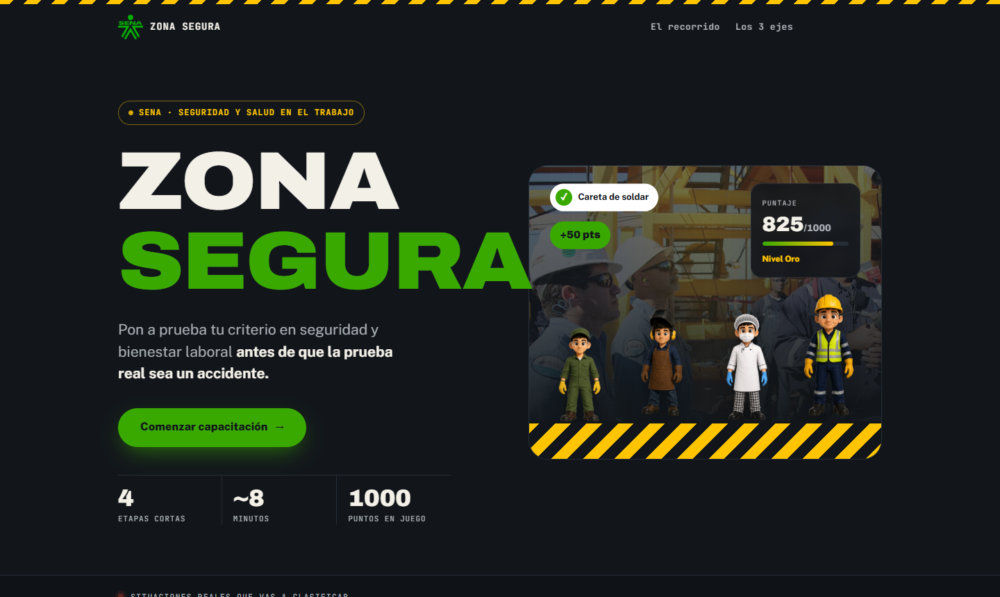
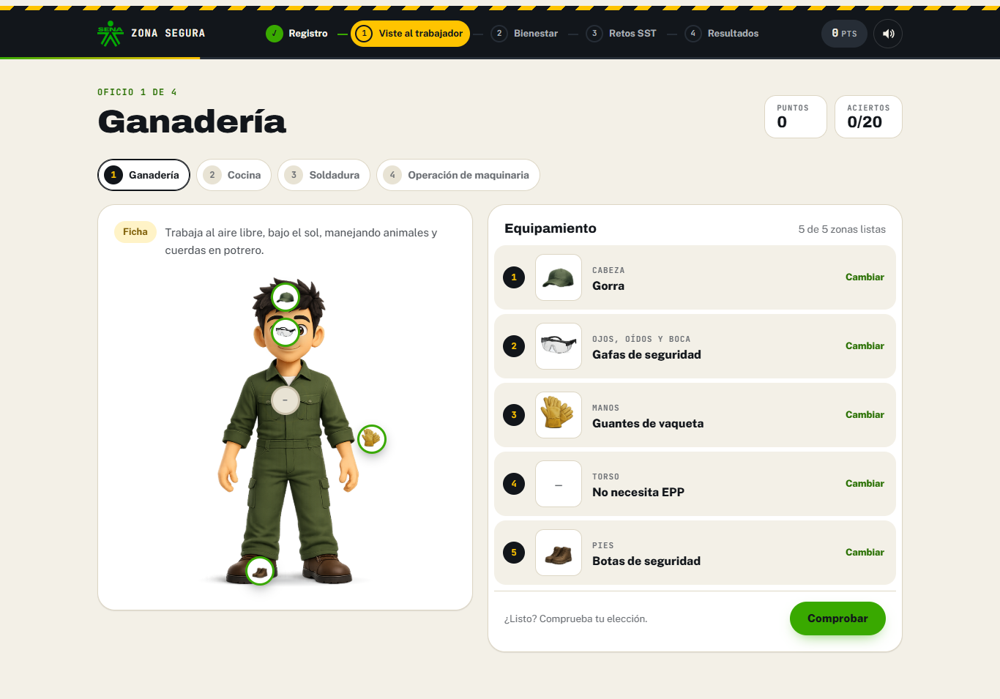
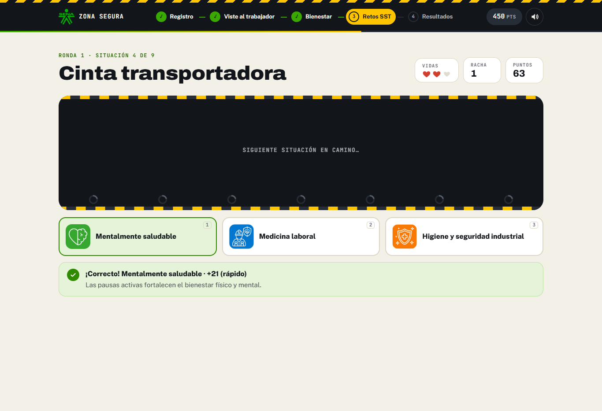
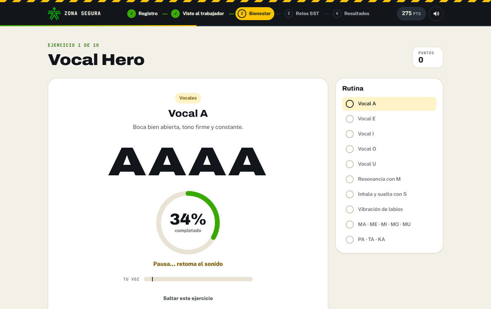
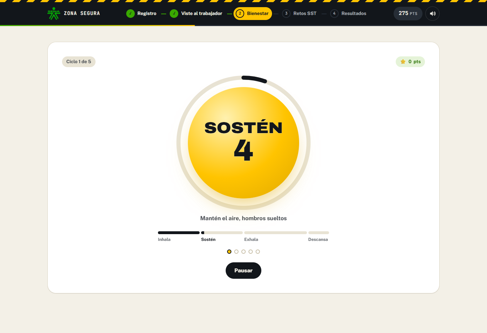
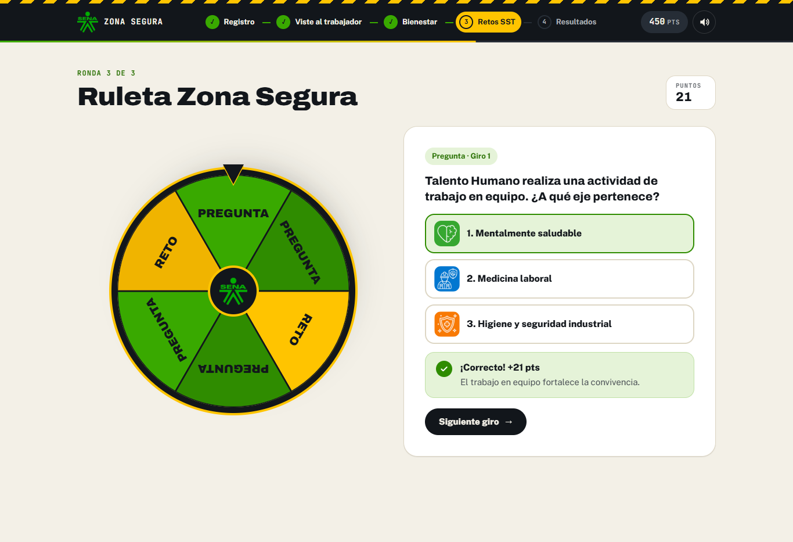
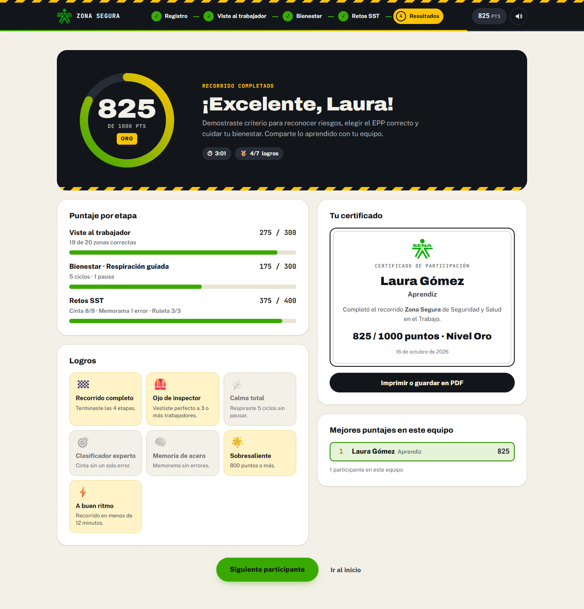

# Zona Segura · Capacitación SST del SENA

Recorrido interactivo de **Seguridad y Salud en el Trabajo (SST)**: cuatro etapas cortas (unos 8 minutos) que terminan en un puntaje sobre 1000, logros y un certificado de participación imprimible.

<p align="center">
  <a href="https://juanezzzzz.github.io/zona-segura-sst/">
    
  </a>
</p>



|  |  |
| :---: | :---: |
| **Viste al trabajador** | **Cinta transportadora** |
|  |  |
| **Vocal Hero** | **Respiración guiada** |
|  |  |
| **Ruleta** | **Resultados y certificado** |
|  |  |

## El recorrido

| # | Etapa | Qué se hace | Puntos |
|---|---|---|---|
| — | **Registro** | Nombre y rol del participante; se arma un carnet en vivo. | — |
| 1 | **Viste al trabajador** | Elegir el EPP correcto en 5 zonas del cuerpo para 3 oficios sorteados entre ganadería, cocina, soldadura y maquinaria. Cada error se corrige con su explicación. | 300 |
| 2 | **Bienestar** | Se elige uno: **Vocal Hero** (6 ejercicios con detección de voz por micrófono) o **Respiración guiada** (3 ciclos 4-4-6-2). | 300 |
| 3 | **Retos SST** | Cinta transportadora (clasificar 6 situaciones en los 3 ejes), memorama (4 parejas) y ruleta (2 giros de pregunta o reto en vivo). | 400 |
| 4 | **Resultados** | Puntaje total, nivel, desglose por etapa, logros, ranking del equipo y certificado. | — |

El recorrido es **lineal**: no se puede adelantar por URL ni repetir una etapa ya completada. Al terminar, el botón *Siguiente participante* reinicia todo para la próxima persona (el ranking se conserva).

### Saltar etapas y rondas

Para que nadie se quede atascado:

- La barra superior tiene **Saltar etapa** en EPP, Bienestar y Retos SST. Pide confirmación y conserva los puntos ya ganados en esa etapa.
- Cada ronda de los Retos SST tiene **Saltar ronda** (un clic, sin confirmación).
- Si se acaban las vidas en la cinta o en el memorama, se puede reintentar o seguir a la siguiente ronda con los puntos que se lleven.
- En los resultados, la etapa saltada aparece marcada como «etapa saltada».

## Cómo ejecutarlo

No requiere instalación ni compilación.

```bash
python -m http.server 8000
# abrir http://localhost:8000
```

> El micrófono de Vocal Hero solo funciona en un contexto seguro (`https://` o `localhost`). Si se abre `index.html` con doble clic, el navegador puede bloquearlo; en ese caso la pantalla ofrece cambiar a Respiración guiada.

## Estructura

```
index.html                 Inicio
games/
  introduccion.html        Registro (carnet)
  epp.html                 Etapa 1
  elegir.html              Etapa 2 · elección
  vocal-hero.html          Etapa 2 · Vocal Hero
  respiracion-guiada.html  Etapa 2 · Respiración
  sena.html                Etapa 3 · Retos SST
  resultados.html          Etapa 4
css/
  app.css                  Sistema de diseño (tokens, componentes, barra del recorrido)
  home.css · registro.css · epp.css · bienestar.css · sena.css · resultados.css
js/
  core.js                  Estado único, guardia de etapas, barra superior, UI y sonido
  data.js                  Todo el contenido pedagógico (situaciones, EPP, preguntas…)
  home.js · registro.js · epp.js · vocal.js · vocal-audio.js · respiracion.js · sena.js · resultados.js
assets/                    Imágenes (EPP, ejes, logo) y sonido
```

### Puntaje

Cada módulo calcula un puntaje crudo y `ZS.store.scale()` lo convierte a la escala del recorrido (peso de la etapa / máximo crudo). Así los puntos que se ven durante el juego son los mismos que suma la barra superior y que llegan a los resultados.

| Módulo | Máximo crudo | Regla |
|---|---|---|
| EPP | 180 | 10 por zona correcta + 10 por oficio perfecto (3 oficios) |
| Vocal Hero | 230 | 10 por ejercicio + 20 sin interrupciones + 50 por rutina completa (6 ejercicios) |
| Respiración | 100 | 10 por ciclo + 20 al completar + 50 sin pausas (3 ciclos) |
| Retos SST | 195 | Cinta 105 · Memorama 60 · Ruleta 30 |

### Datos

Todo vive en el navegador (`localStorage`): `zs:v2` (recorrido actual), `zs:history` (ranking del equipo) y `zs:muted` (sonido). No hay servidores, cuentas ni analítica.

### Cambiar el contenido

Las situaciones, el catálogo de EPP, las respuestas por oficio, las preguntas de la ruleta, los retos y los ejercicios están en [`js/data.js`](js/data.js). Agregar una situación o una pregunta no requiere tocar la lógica.

## Accesibilidad

- Navegación completa con teclado (en la cinta: teclas `1`, `2`, `3`; en respiración: `Espacio` para pausar).
- Diálogos nativos `<dialog>` con foco gestionado; avisos en regiones `aria-live`.
- Contraste AA en texto, foco visible y soporte para `prefers-reduced-motion`.
- Diseño responsive desde 360 px; el selector de EPP se convierte en hoja inferior en móvil.

## Hoja de ruta

Ver [ROADMAP.md](ROADMAP.md).

## Licencia

Uso libre para fines educativos y de bienestar.
